# GIS map tutorials

Maps and videos of storms, oceans, rivers and cities, each with the recipe that makes it: what the map shows, the
data, the steps, the code and the result. Every recipe is a Python script, an executed Jupyter notebook and a Google
Colab notebook that runs with no key and no account, also from a phone.

**Gallery, steps and code: <https://shammun.github.io/gis-map-tutorials/>**

Maps created by Shammunul Islam.

## The maps and their recipes

| Map | What it is | Recipe |
|---|---|---|
| [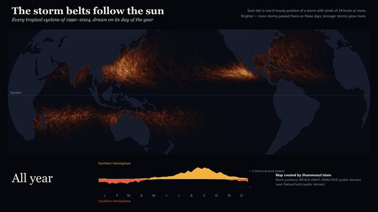](https://shammun.github.io/gis-map-tutorials/#glow_season) | **The storm belts follow the sun.** Tropical cyclones of 1990-2024 as dots of light on their calendar day (IBTrACS). Poster + video | [](https://colab.research.google.com/github/shammun/gis-map-tutorials/blob/main/tutorials/gis_styles/01_glow_season_colab.ipynb) · [page](https://shammun.github.io/gis-map-tutorials/tutorials/01_glow_season.html) · [notebook](tutorials/gis_styles/01_glow_season.ipynb) · [.py](tutorials/gis_styles/01_glow_season.py) |
| [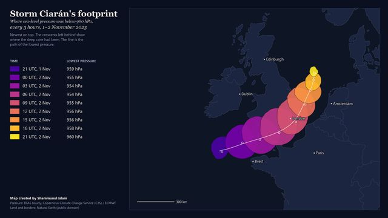](https://shammun.github.io/gis-map-tutorials/#epoch_footprints) | **Storm Ciarán's footprint.** Where sea-level pressure was below 960 hPa every 3 hours (ERA5). Poster + video | [](https://colab.research.google.com/github/shammun/gis-map-tutorials/blob/main/tutorials/gis_styles/02_epoch_footprints_colab.ipynb) · [page](https://shammun.github.io/gis-map-tutorials/tutorials/02_epoch_footprints.html) · [notebook](tutorials/gis_styles/02_epoch_footprints.ipynb) · [.py](tutorials/gis_styles/02_epoch_footprints.py) |
| [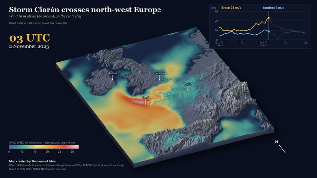](https://shammun.github.io/gis-map-tutorials/#block_diagram) | **Storm Ciarán crosses north-west Europe.** 10-m wind on a 3-D block of relief, with a chart for Brest and London (ERA5, ETOPO 2022). Poster + video | [](https://colab.research.google.com/github/shammun/gis-map-tutorials/blob/main/tutorials/gis_styles/03_block_diagram_colab.ipynb) · [page](https://shammun.github.io/gis-map-tutorials/tutorials/03_block_diagram.html) · [notebook](tutorials/gis_styles/03_block_diagram.ipynb) · [.py](tutorials/gis_styles/03_block_diagram.py) |
| [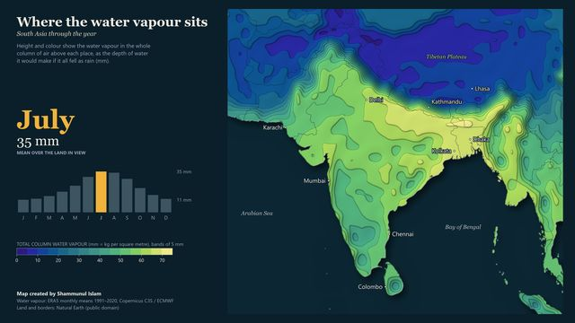](https://shammun.github.io/gis-map-tutorials/#relief_field) | **Where the water vapour sits.** South Asia, monthly water vapour 1991-2020 as lit terraces (ERA5). Poster + video | [](https://colab.research.google.com/github/shammun/gis-map-tutorials/blob/main/tutorials/gis_styles/04_relief_field_colab.ipynb) · [page](https://shammun.github.io/gis-map-tutorials/tutorials/04_relief_field.html) · [notebook](tutorials/gis_styles/04_relief_field.ipynb) · [.py](tutorials/gis_styles/04_relief_field.py) |
| [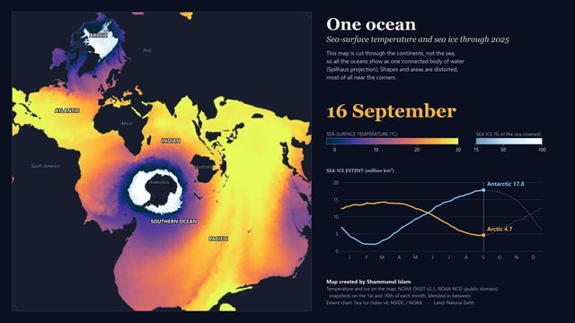](https://shammun.github.io/gis-map-tutorials/#spilhaus_ocean) | **One ocean.** Sea-surface temperature and sea ice through 2025 on a map cut through the continents (OISST, NSIDC). Poster + video | [](https://colab.research.google.com/github/shammun/gis-map-tutorials/blob/main/tutorials/gis_styles/05_spilhaus_ocean_colab.ipynb) · [page](https://shammun.github.io/gis-map-tutorials/tutorials/05_spilhaus_ocean.html) · [notebook](tutorials/gis_styles/05_spilhaus_ocean.ipynb) · [.py](tutorials/gis_styles/05_spilhaus_ocean.py) |
| [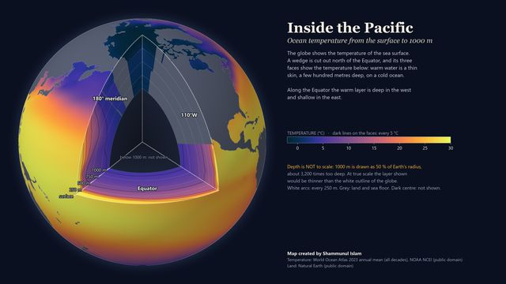](https://shammun.github.io/gis-map-tutorials/#cutaway_globe) | **Inside the Pacific.** A cut-away globe of ocean temperature, surface to 1000 m (World Ocean Atlas 2023). Poster + video | [](https://colab.research.google.com/github/shammun/gis-map-tutorials/blob/main/tutorials/gis_styles/06_cutaway_globe_colab.ipynb) · [page](https://shammun.github.io/gis-map-tutorials/tutorials/06_cutaway_globe.html) · [notebook](tutorials/gis_styles/06_cutaway_globe.ipynb) · [.py](tutorials/gis_styles/06_cutaway_globe.py) |
| [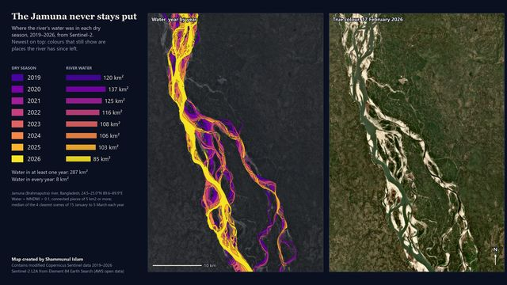](https://shammun.github.io/gis-map-tutorials/#river_epochs) | **The Jamuna never stays put.** The river's water in the dry seasons of 2019-2026 (Sentinel-2, no key; Google Earth Engine is an optional section of the same notebook). Video | [](https://colab.research.google.com/github/shammun/gis-map-tutorials/blob/main/tutorials/gis_styles/07_satellite_river_epochs_colab.ipynb) · [page](https://shammun.github.io/gis-map-tutorials/tutorials/07_satellite_river_epochs.html) · [notebook](tutorials/gis_styles/07_satellite_river_epochs.ipynb) · [.py](tutorials/gis_styles/07_satellite_river_epochs.py) |
| [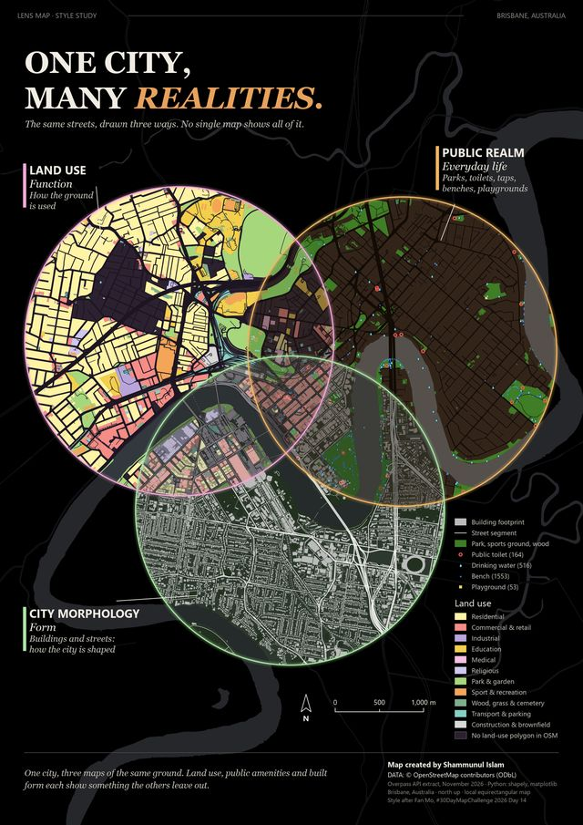](https://shammun.github.io/gis-map-tutorials/#lens_brisbane) [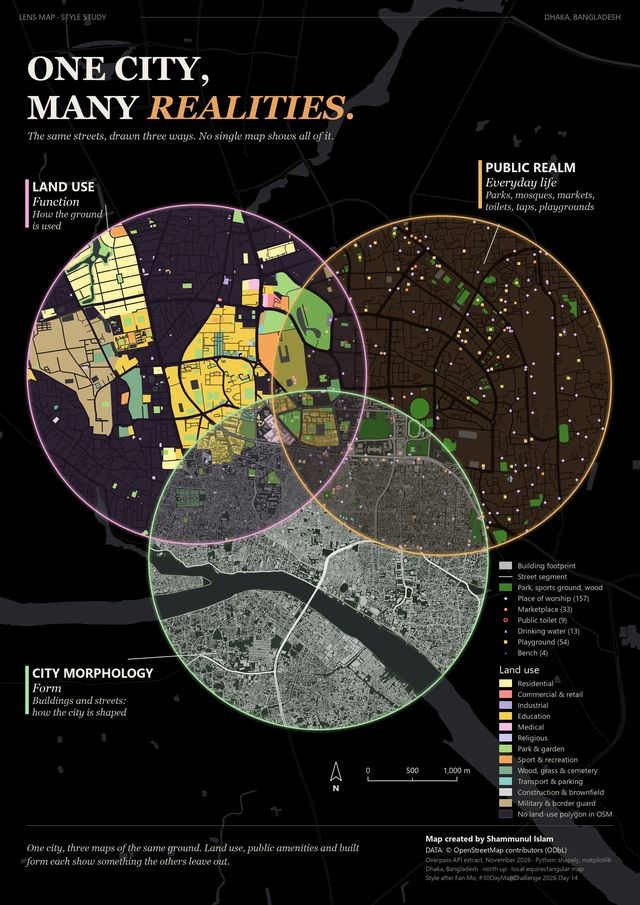](https://shammun.github.io/gis-map-tutorials/#lens_dhaka) [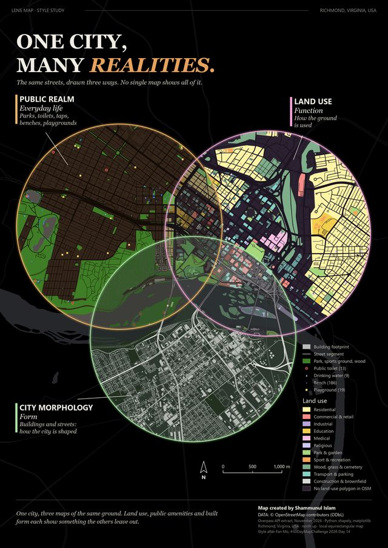](https://shammun.github.io/gis-map-tutorials/#lens_richmond) | **One city, many realities.** Lens maps of Brisbane, Dhaka and Richmond (land use, public realm, built form) from OpenStreetMap, and of any other place you choose. Poster + video + GIF | [](https://colab.research.google.com/github/shammun/gis-map-tutorials/blob/main/tutorials/lens_maps/01_lens_city_osm_colab.ipynb) · [page](https://shammun.github.io/gis-map-tutorials/tutorials/01_lens_city_osm.html) · [notebook](tutorials/lens_maps/01_lens_city_osm.ipynb) · [.py](tutorials/lens_maps/01_lens_city_osm.py) |
| [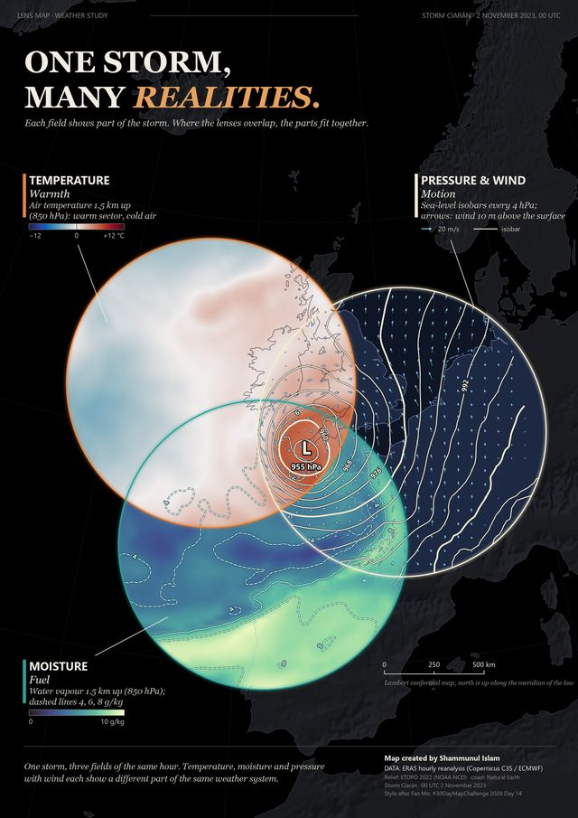](https://shammun.github.io/gis-map-tutorials/#lens_weather) | **One storm, many realities.** Storm Ciarán through three lenses: temperature, moisture, pressure and wind (ERA5). Poster + video + GIF | [](https://colab.research.google.com/github/shammun/gis-map-tutorials/blob/main/tutorials/lens_maps/02_lens_weather_era5_colab.ipynb) · [page](https://shammun.github.io/gis-map-tutorials/tutorials/02_lens_weather_era5.html) · [notebook](tutorials/lens_maps/02_lens_weather_era5.ipynb) · [.py](tutorials/lens_maps/02_lens_weather_era5.py) |
| [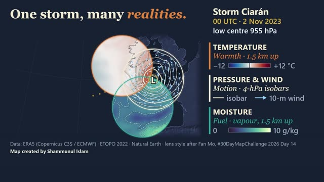](https://shammun.github.io/gis-map-tutorials/#lens_map) | **The lenses ride the storm.** A 41-second clip: the three lenses follow the low. Python makes the layers (and a pure-Python version); the final render uses [Remotion](remotion/lens_map/) on your own machine (Node.js). Video | [](https://colab.research.google.com/github/shammun/gis-map-tutorials/blob/main/tutorials/lens_maps/03_lens_map_clip_colab.ipynb) · [page](https://shammun.github.io/gis-map-tutorials/tutorials/03_lens_map_clip.html) · [notebook](tutorials/lens_maps/03_lens_map_clip.ipynb) · [.py](tutorials/lens_maps/03_lens_map_clip.py) |
| [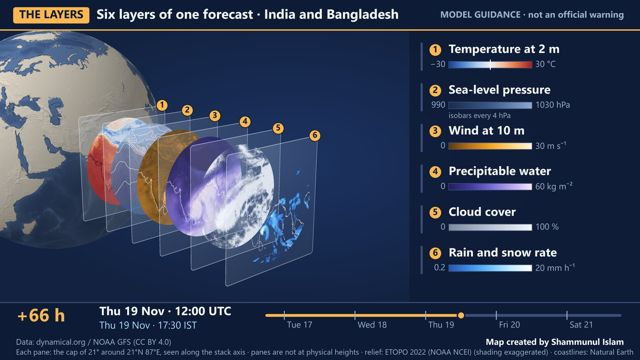](https://shammun.github.io/gis-map-tutorials/#glass_stack) | **Glass-pane globe stack.** A relief globe with six glass panes, each a different field of one NOAA GFS forecast (dynamical.org). Poster + video in pure Python; a second video with [Remotion](remotion/glass_stack/) on your own machine (Node.js) | [](https://colab.research.google.com/github/shammun/gis-map-tutorials/blob/main/tutorials/glass_stack/01_glass_stack_colab.ipynb) · [page](https://shammun.github.io/gis-map-tutorials/tutorials/01_glass_stack.html) · [notebook](tutorials/glass_stack/01_glass_stack.ipynb) · [.py](tutorials/glass_stack/01_glass_stack.py) |

The maps (JPG and full-size PNG), the videos (MP4) and the GIFs are in [`docs/media/`](docs/media/).

## A lens map of any place

```
python -m gismaps.lens city --place "Chittagong" --outputs poster,video,gif
python -m gismaps.lens city --lat 23.72 --lon 90.40 --outputs poster
python -m gismaps.lens city --preset brisbane --outputs poster,video,gif --full
```

```python
from gismaps.lens import make_city
made = make_city(place="Nairobi, Kenya", outputs=("poster",), fast=True, out_dir="out")
```

A place name is looked up with OpenStreetMap's Nominatim; a latitude and longitude are turned back into a city and
country for the title. The three lenses are laid out automatically, the OpenStreetMap layers are downloaded from the
public Overpass servers (cached, with retries) and the legend is built from what is mapped there. `--outputs` takes
any of `poster`, `video`, `gif`. Without `--full` the map covers a smaller area and the video is a small preview.
In the Colab notebook the same is a form (place or "lat, lon", tick boxes), a tap on a map, or a small panel. The
[web page](https://shammun.github.io/gis-map-tutorials/#your-city) has a map that writes the form values and the
command for you.

## How every notebook is laid out

- **First cell:** what the notebook makes, and "Tap ▸ Runtime ▸ Run all".
- **One settings cell** holds everything you may change. It ends with **STOP checks**: a setting that cannot work
  halts the notebook there, with a plain message, before anything slow starts.
- **A coloured banner on every step:** green = run it; orange = a setting you may change, then run; blue or grey =
  optional or conditional.
- **Every picture and video is shown in the notebook**, as wide as the screen (also a phone's).
- **A verification cell** checks the outputs and prints PASS or FAIL per check.
- **A last cell** offers the outputs as one download on Colab.
- **Google Earth Engine** appears only inside the river recipe, as an optional section after the default route that
  needs no key (`USE_GEE = False` by default). To use it, set `USE_GEE = True` and put your own Cloud project id in
  `PROJECT_ID = "your-gcp-project"`. Its exports pass `crs`, `crsTransform` and `dimensions` and no region, so every
  file lands on exactly the same pixels.

## Run on Google Colab

Tap a badge above, then **Runtime ▸ Run all**. The first code cell installs this repository's package:

```
%pip install -q git+https://github.com/shammun/gis-map-tutorials
```

The small input files are downloaded from this repository the first time they are used. Outputs are written to
`/content/out`, shown in the notebook and offered as a download. The default mode is quick (a few minutes per
notebook on a free runtime: a small poster and a short preview clip). For the full-size poster and the whole video
set `MODE = "FULL"` in the settings cell (lens maps: `QUICK = False`).

## Run on your own machine

Python 3.10 or newer.

```
git clone https://github.com/shammun/gis-map-tutorials.git
cd gis-map-tutorials
python -m venv .venv
.venv/bin/python -m pip install -e ".[all]"       # Windows: .venv\Scripts\python -m pip install -e ".[all]"

.venv/bin/python tutorials/gis_styles/01_glow_season.py             # quick: poster 1920 x 1080 + a preview clip, into ./out/
.venv/bin/python tutorials/gis_styles/01_glow_season.py --full      # poster 3840 x 2160 + the whole video
.venv/bin/python tutorials/lens_maps/01_lens_city_osm.py
.venv/bin/python -m jupyter lab tutorials/                          # or as notebooks
```

`pip install -e .` alone is enough for every recipe in its default mode, except the live Sentinel-2 cells of the
river recipe (`pip install pystac-client rasterio`; without them the notebook uses the shipped file) and the optional
cloud route of the storm lens map (`pip install zarr gcsfs`).

Videos use the `ffmpeg` on your PATH, or the one that `imageio-ffmpeg` brings. Fonts: Georgia and Segoe UI where they
exist (Windows), DejaVu Serif and DejaVu Sans elsewhere (Linux, Colab); the layouts hold with both.

The two clips made with Remotion need Node.js 18 or newer:

```
python tutorials/lens_maps/03_lens_map_clip.py      # writes out/lens_layers/
cd remotion/lens_map && npm install
npx remotion render src/index.ts LensMapClip out/lens_map.mp4 --public-dir=../../out/lens_layers
```

```
python -m gismaps.glass.remotion remotion/glass_stack/public     # writes the relief, 40 pane pictures and a manifest
cd remotion/glass_stack && npm install
npx remotion render src/index.ts GlassStack out/glass_stack_remotion.mp4 --public-dir=public
```

Optional environment variables:

| Variable | Effect |
|---|---|
| `GIS_MODE` | weather / ocean / river / glass-stack recipes: `FAST` (default) or `FULL` (the same as `--full`) |
| `GIS_SOURCE` | glass stack: `shipped` (default) or `live` (read the forecast from dynamical.org; `pip install icechunk zarr`) |
| `GIS_OUT`, `LENS_OUT` | output folder (default `./out`; `/content/out` on Colab) |
| `GIS_WORKERS` | parallel frame workers of a FULL script run (default 6; lower it if memory runs out) |
| `LENS_ERA5` | storm lens map: `reduced` (default, the shipped 0.5° copy) or `arco` (full 0.25° fields from the cloud store, about 230 MB of transfer) |
| `LENS_QUICK` | lens maps: `1` (default) = small preview videos; `0` = full-size videos |
| `GISMAPS_DATA` | a folder of your own for the input files |
| `GIS_FONTS=dejavu`, `LENS_FONTS=dejavu` | preview the Colab fonts on Windows |

## Repository layout

```
gismaps/                 the Python package behind the maps  (pip install -e .)
  styles/                the seven weather / ocean / river maps: common (map grid, compositing, type, video writer),
                         glow, epochs, block, relief, spilhaus, cutaway, satellite
  lens/                  lens maps: common (the lens rule), cities, osm, city, weather, anim, make (any place), picker
  glass/                 the glass-pane globe stack: gfs (data), ortho, panes, render (ray caster), stack, remotion (inputs)
  data.py                finds the input files; downloads them when missing
  nb.py                  notebook helpers: show a picture or a video, STOP checks, PASS / FAIL, download
  prepare_data.py        how every reduced input of the seven maps is made from its public source
tutorials/               the recipes:  NN_name.py · NN_name.ipynb (executed) · NN_name_colab.ipynb
data/                    small reduced inputs (each with its source and licence below)
remotion/                the Remotion sources of the clips rendered with Node.js
docs/                    the web page (GitHub Pages): index.html, tutorials/*.html, media/
tools/                   build_notebooks.py (script → notebooks), build_site.py (web page), check_site.py, catalog.py
```

Edit the `.py` recipes, never the notebooks; then `python tools/build_notebooks.py` (executes them),
`python tools/build_site.py` and `python tools/check_site.py`.

## Data, credits and licences

The code is under the [MIT licence](LICENSE). The data keep their own licences. The repository ships small reduced
copies so the recipes run in minutes; every recipe also shows the route to the original public source, and a missing
file is downloaded (or, for the seven maps, rebuilt from the source by `gismaps/prepare_data.py`).

| File in `data/` | Made from | Source (no key) | Licence / credit to print |
|---|---|---|---|
| `gis_styles/cyclones.npz` | 6-hourly best-track positions ≥ 34 kt, all basins, 1990-2024 | [IBTrACS v04r01](https://www.ncei.noaa.gov/products/international-best-track-archive), NOAA NCEI | public domain; Knapp et al. (2010) |
| `gis_styles/ciaran.npz` | hourly sea-level pressure and 10-m wind, 1-2 Nov 2023, 40-62°N 25°W-10°E | [ERA5](https://cds.climate.copernicus.eu/datasets/reanalysis-era5-single-levels) through ARCO-ERA5 on Google Cloud | Contains modified Copernicus Climate Change Service information (ERA5, C3S / ECMWF) |
| `gis_styles/terrain_nweurope.npz` | surface elevation 40-58°N 12°W-10°E at 2′ | [ETOPO 2022](https://www.ncei.noaa.gov/products/etopo-global-relief-model), NOAA NCEI | public domain |
| `gis_styles/tcwv_southasia.npz` | monthly means 1991-2020 of total column water vapour, 0-45°N 55-105°E, 1° | [ERA5 monthly means](https://cds.climate.copernicus.eu/datasets/reanalysis-era5-single-levels-monthly-means) (Copernicus CDS, free account); keyless fallback in the builder: NCEP/NCAR Reanalysis 1, NOAA PSL | Contains modified Copernicus Climate Change Service information (ERA5, C3S / ECMWF) |
| `gis_styles/oisst_2025.npz` | sea-surface temperature and sea ice on the 1st and 16th of each month of 2025 at 0.5°; daily sea-ice extent | [NOAA OISST v2.1](https://www.ncei.noaa.gov/products/optimum-interpolation-sst) (NCEI); [Sea Ice Index v4](https://nsidc.org/data/g02135) (NSIDC) | public domain; Huang et al. (2021); Fetterer et al. (2017) |
| `gis_styles/woa23_temperature.npz` | annual-mean temperature, 0-2000 m, 1° | [World Ocean Atlas 2023](https://www.ncei.noaa.gov/products/world-ocean-atlas), NOAA NCEI | public domain; Locarnini et al. (2024) |
| `gis_styles/jamuna_s2.npz` | yearly river masks (median MNDWI of the 4 clearest dry-season scenes, 40 m) and the newest true-colour image | Sentinel-2 L2A through [Element 84 Earth Search](https://earth-search.aws.element84.com/v1) (STAC, AWS open data) | Contains modified Copernicus Sentinel data 2019-2026 |
| `gis_styles/jamuna_s2_gee.npz` | the same masks from median composites of all clear scenes | Google Earth Engine, `COPERNICUS/S2_SR_HARMONIZED` (account) | Contains modified Copernicus Sentinel data 2019-2026, processed with Google Earth Engine |
| `lens_maps/<city>_lens_layers.json.gz` | OpenStreetMap layers of Brisbane, Dhaka and Richmond, clipped to the ground the lenses can reach | [OpenStreetMap](https://www.openstreetmap.org/copyright) through the Overpass API | © OpenStreetMap contributors, Open Database Licence (ODbL) 1.0. These three files are an ODbL-licensed derived database |
| `lens_maps/era5_ciaran_lens_0p5deg.nc` | 25 hours of sea-level pressure, 10-m wind, 850-hPa temperature and humidity, every second grid point | ERA5 through ARCO-ERA5 | Contains modified Copernicus Climate Change Service information (ERA5, C3S / ECMWF); Hersbach et al. (2020) |
| `lens_maps/etopo2022_10min_natl.nc` | every 10th point of the 60″ relief grid, North Atlantic | ETOPO 2022, NOAA NCEI | public domain |
| `glass_stack/gfs_south_asia_20261116T18.nc`, `gfs_hemisphere_20261116T18.nc` | six (five) fields of the NOAA GFS run of 16 Nov 2026 18 UTC: 0-44°N 62-112°E at 0.25°, leads +6 to +102 h; a hemisphere centred on 45°N 30°W at 0.5°, leads +6 to +48 h | NOAA GFS as published by [dynamical.org](https://dynamical.org) (anonymous) | CC BY 4.0; credit "dynamical.org / NOAA GFS" |
| `glass_stack/etopo2022_10min.nc` | global relief at 10 arc-minutes, heights rounded to 5 m | ETOPO 2022, NOAA NCEI | public domain |

Land, coast and borders come from [Natural Earth](https://www.naturalearthdata.com) (public domain), downloaded when
first used. Colour maps: cmocean (Thyng et al. 2016) and matplotlib.

**Maps and videos** (`docs/media/`): created by Shammunul Islam. They may be reused with the credit lines they carry
("Map created by Shammunul Islam" and the data credits).

**Lens maps**: style after Fan Mo, #30DayMapChallenge 2026 Day 14 ("Borgesian map": three lenses over Brisbane). The
style was reproduced with my own data and code; nothing was traced or copied.

References: Fetterer et al. (2017), Sea Ice Index, NSIDC · Hersbach et al. (2020), *Q. J. R. Meteorol. Soc.* 146,
1999-2049 · Huang et al. (2021), *J. Climate* 34, 2923-2939 · Knapp et al. (2010), *Bull. Amer. Meteor. Soc.* 91,
363-376 · Locarnini et al. (2024), World Ocean Atlas 2023, Volume 1: Temperature · Thyng et al. (2016),
*Oceanography* 29(3), 9-13 · Xu (2006), *Int. J. Remote Sens.* 27, 3025-3033 (MNDWI).
